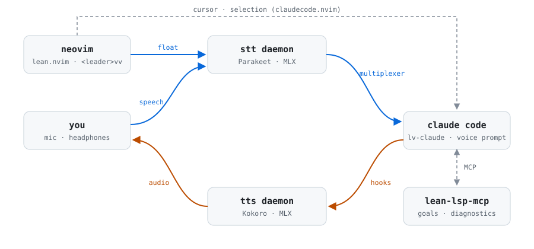

# lean-voice

Work on Lean proofs with Claude Code by talking to it. Press a key in Neovim, say what you want, and the agent reads the goal through Lean, does the work, and answers out loud. Speech recognition and synthesis both run locally on Apple Silicon.

<p align="center">
  
</p>

## What a turn sounds like

You put the cursor on a `sorry`, press `<leader>vv` and say *"what's the goal here, would simp close it?"* A float shows the transcript as you speak. Enter sends it.

Claude says *"Let me check."*, calls `lean_goal` and `lean_multi_attempt` without narrating each step, and then says something like *"You need n plus one plus b to equal b plus n plus one, with the induction hypothesis for n. Simp makes no progress; omega closes it."* Pressing `<leader>vv` again while it talks cuts it off.

## Pieces

| | Runs | Does |
|---|---|---|
| `lua/lean_voice` | Neovim | push-to-talk float, `:LeanVoice` command, auto-saves `*.lean` on pause |
| `src/lean_voice/stt.py` | daemon | owns the mic and transcribes with [Parakeet](https://github.com/senstella/parakeet-mlx) on MLX |
| `src/lean_voice/tts.py` | daemon | speaks with [Kokoro](https://huggingface.co/hexgrad/Kokoro-82M) on MLX, one sentence ahead of playback |
| `src/lean_voice/mux.py` | daemon | types the transcript into Claude's pane: tmux, zellij, herdr, cmux or Rex |
| `hooks/speak.py` | Claude Code hook | speaks new assistant text before each tool call and at the end of the turn |
| `claude/voice-prompt.md` | Claude Code | appended system prompt: short spoken replies, no code read aloud, goals in words |
| `bin/lv-claude` | your shell | starts the daemons, registers its pane for voice input, runs `claude --ide` with the hooks and prompt |

The hooks only load in sessions started with `lv-claude`. Your other Claude Code sessions stay silent.

## Requirements

- Apple Silicon Mac (MLX)
- A terminal multiplexer: tmux, zellij, herdr, cmux or Rex (see [below](#multiplexers))
- Neovim 0.11+ with [lazy.nvim](https://github.com/folke/lazy.nvim) and [lean.nvim](https://github.com/Julian/lean.nvim)
- [Claude Code](https://docs.anthropic.com/en/docs/claude-code), [uv](https://docs.astral.sh/uv/), `fzf`
- Headphones. There's no echo cancellation yet, so speakers will feed the mic.


## Install

**1. The plugin.** Add a spec to your lazy.nvim config. `build` creates the Python environment inside the plugin directory. Loading is cheap (`setup()` only defines keymaps, a command and an autocmd), so it loads on `VeryLazy` instead of waiting for a Lean file.

```lua
{
  "tytrdev/lean-voice",
  event = "VeryLazy",
  build = "uv sync",
  dependencies = {
    {
      "coder/claudecode.nvim", -- lets Claude see your file, cursor and selection
      dependencies = { "folke/snacks.nvim" },
      opts = { terminal = { provider = "none" } }, -- Claude runs in its own pane
    },
  },
  opts = {},
}
```

**2. The models.** About 2.9 GB from Hugging Face (Parakeet 2.5 GB, Kokoro 0.36 GB), once:

```vim
:LeanVoice setup
```

**3. Lean tools for Claude.**

```sh
claude mcp add --scope user lean-lsp -- uvx lean-lsp-mcp
```

**4. A launcher on your PATH.**

```sh
ln -s ~/.local/share/nvim/lazy/lean-voice/bin/lv-claude ~/.local/bin/lv-claude
```

Then `:checkhealth lean_voice` checks all of the above.

## Use

In a Lean project, open Neovim in one pane and run `lv-claude` from the same directory in another. `lv-claude` registers its pane, and voice input goes there until another `lv-claude` takes over. Claude only connects to Neovim when its working directory is inside Neovim's.

| Key | Command | |
|---|---|---|
| `<leader>vv` | `:LeanVoice talk` | push to talk. `<CR>` sends, `<Esc>` cancels |
| `<leader>vo` | `:LeanVoice toggle` | listening off (mic never opens) or back on |
| `<leader>vc` | `:LeanVoice voice` | pick a voice. Moving the cursor plays a sample |
| | `:LeanVoice status` | daemons, models, logs |
| | `:LeanVoice logs` | open the daemon logs |
| | `:LeanVoice start` · `stop` · `restart` | the daemons (`lv-claude` starts them for you) |

Messages sent by voice start with `[command]`. The prompt tells Claude to answer those with a short acknowledgement and then report back when it's done.

## Configure

Plugin options, shown with their defaults:

```lua
opts = {
  autosave = true, -- lean-lsp-mcp reads files from disk, so unsaved edits are invisible to it
  keys = { talk = "<leader>vv", toggle = "<leader>vo", voice = "<leader>vc" }, -- false disables one
}
```

Voice settings live in `~/.config/lean-voice/config.json` and are re-read for every reply, so changes apply immediately:

```json
{ "voice": "bf_lily", "speed": 1.1, "listen": "ptt" }
```

| Environment variable | Default | |
|---|---|---|
| `LEAN_VOICE_MUX` | detected | force an adapter: `tmux`, `zellij`, `herdr`, `cmux`, `rex` |
| `LEAN_VOICE_TTS_MODEL` | `prince-canuma/Kokoro-82M` | |
| `LEAN_VOICE_STT_MODEL` | `mlx-community/parakeet-tdt-0.6b-v3` | |
| `LEAN_VOICE_HOOK_LOG` | unset | `1` logs every hook payload to `~/.cache/lean-voice/hooks.log` |

The daemons are background processes, detached from any terminal. Their sockets, PID files and logs are in `~/.cache/lean-voice/`. Both speak newline-delimited JSON, so another editor could drive them; the protocol is in the docstrings at the top of `stt.py` and `tts.py`.

## Multiplexers

`lv-claude` detects the multiplexer it's running in and records its own pane in `~/.cache/lean-voice/target.json`. The STT daemon types transcripts there and presses Enter. Detection goes innermost first, so tmux running inside Rex counts as tmux.

| | Detected by | Types with | Tested |
|---|---|---|---|
| tmux | `TMUX_PANE` | `tmux send-keys -l` | 3.8 |
| zellij | `ZELLIJ_PANE_ID` | `zellij action write-chars --pane-id` | 0.45 |
| herdr | `HERDR_PANE_ID` | `herdr pane send-text` | 0.9.5 |
| cmux | `CMUX_SURFACE_ID` | `cmux send --surface` | not yet |
| Rex | `REX_BLOCK` | `rex send` | 0.1 beta |

cmux by default only lets processes started inside cmux use its socket. The daemons are started from `lv-claude` but detach from it, so they may not count. If delivery fails, `:LeanVoice logs` will show it.

An adapter is a small class in `src/lean_voice/mux.py`:

```python
class Tmux(Adapter):
    name, detect_var, env_vars = "tmux", "TMUX_PANE", ("TMUX",)

    def commands(self, t, text):
        sock = ["-S", t.env["TMUX"].split(",")[0]] if t.env.get("TMUX") else []
        return [["tmux", *sock, "send-keys", "-t", t.pane, "-l", text],
                ["tmux", *sock, "send-keys", "-t", t.pane, "Enter"]]
```

`env_vars` are copied from the Claude pane at registration and passed back when the daemon runs the commands, so the CLI reaches the right server or session.

## Notes on Claude Code hooks

These took some poking to find out:

- At `PreToolUse`, text the model wrote before the tool call is already in the transcript.
- At `Stop`, the final text block usually isn't in the transcript yet, but the payload carries it as `last_assistant_message`.
- The transcript JSONL holds one content block per line, each with its own `uuid`, which makes "what's new since last time" a set difference.

## Roadmap

- Conversation mode: always listening, with turn detection and interrupting by voice
- A "hey Claude" wake word ([openWakeWord](https://github.com/dscripka/openWakeWord)), behind the same off switch
- A visual window next to the terminal for goal states and ProofWidgets
- A typed scene DSL for mathematical exposition

## License

[MIT](LICENSE)
